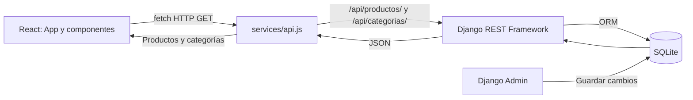

# Ejercicio 05: integración de React con Django

## Objetivo

El catálogo deja de importar los datos simulados de `products.js`. React consulta productos y categorías de SQLite mediante los servicios JSON del Ejercicio 04. Se conserva el rediseño, los componentes, Tailwind CSS y shadcn/ui.

## Diez actividades realizadas

| Actividad | Implementación |
| --- | --- |
| 1. Identificar endpoints | Se consultaron realmente GET /api/productos/ y GET /api/categorias/ antes de implementar la integración |
| 2. Servicio HTTP | `frontend/src/services/api.js` centraliza fetch y la dirección VITE_API_URL, comprueba response.ok y que la respuesta sea un arreglo |
| 3. Productos | obtenerProductos(signal) consulta /api/productos/ |
| 4. Categorías | obtenerCategorias(signal) consulta /api/categorias/ |
| 5. Hooks | App usa useEffect y useState para almacenar productos, categorías, selección, carga, error y recarga; AbortController cancela solicitudes anteriores o de componentes desmontados |
| 6. Tarjetas | ProductList recibe los productos de Django y usa id como key; ProductCard muestra nombre, descripcion, precio, imagen_url y categoria_nombre |
| 7. Categorías dinámicas | CategoryFilter recibe categorías de la API; únicamente Todas es una opción fija |
| 8. Filtrado | App compara el id de categoría elegido con producto.categoria. Todas se representa con null y permite ver el listado completo sin recargar la página |
| 9. Estados | Se muestran carga, error, catálogo vacío y categoría sin productos; Actualizar catálogo o Reintentar vuelven a consultar los dos servicios |
| 10. Cambio desde Admin | Se modificó temporalmente un nombre desde un formulario real de Django Admin, se actualizó React y se comprobó el nuevo valor; luego se restauró desde Admin y se comprobó de nuevo |

Si se elimina una categoría desde Admin mientras está seleccionada, al actualizar el catálogo se vuelve a Todas. No se utilizan productos simulados cuando falla la API ni se muestran resultados anteriores como si una consulta fallida hubiera funcionado.

## Flujo de datos



La consulta inicial se hace con useEffect y Promise.all. Ambos listados se guardan juntos cuando las dos solicitudes terminan correctamente. Los filtros operan en React sobre los datos obtenidos; el botón Actualizar catálogo vuelve a solicitar información de Django. No hay actualización automática en tiempo real.

## Archivos principales

- `frontend/src/services/api.js`: funciones HTTP y manejo de respuestas.
- `frontend/.env.example`: dirección de ejemplo del backend, sin secretos.
- `frontend/src/App.jsx`: consultas, estados, cancelación y filtrado.
- `frontend/src/pages/Home.jsx`: mensajes de estado y botón de actualización, conservando el hero y el footer.
- `frontend/src/components/ProductList.jsx`: lista y mensajes vacíos.
- `frontend/src/components/ProductCard.jsx`: campos reales de la API e imágenes individuales.
- `frontend/src/components/CategoryFilter.jsx`: opciones recibidas desde Django e ids de categoría.
- `frontend/public/images/producto-no-disponible.svg`: imagen de respaldo local.
- `backend/config/settings.py`: CORS local limitado a la API.
- `backend/requirements.txt`: agrega django-cors-headers 4.9.0.
- `backend/catalogo/test_cors.py`: pruebas de los orígenes permitidos y bloqueados.

`frontend/src/data/products.js` se conserva como archivo del ejercicio anterior, pero no se importa en la aplicación. No se modificaron modelos, migraciones, rutas ni permisos de escritura del backend.

## Configuración de VITE_API_URL

Ejemplo en `frontend/.env.example`:

```dotenv
VITE_API_URL=http://127.0.0.1:8000/api
```

La dirección incluye `/api`, sin necesidad de una barra final. Si no existe la variable se utiliza esa misma dirección por defecto. Las funciones agregan `/productos/` o `/categorias/`.

Las variables con prefijo VITE_ son públicas y se incorporan al frontend: no deben contener contraseñas ni claves. Copiar el ejemplo a `.env.local` y reiniciar Vite después de cambiarlo. Para una compilación de producción, configurar el valor antes de `npm run build`.

## CORS en Django

Se añadió `corsheaders` a INSTALLED_APPS y `corsheaders.middleware.CorsMiddleware` antes de CommonMiddleware. Solo se autorizan estos orígenes:

```python
CORS_ALLOWED_ORIGINS = [
    "http://localhost:5173",
    "http://127.0.0.1:5173",
]
CORS_URLS_REGEX = r"^/api/.*$"
```

No se permite cualquier origen ni se envían credenciales administrativas desde React. El panel Admin conserva su funcionamiento independiente. Si cambias el puerto de Vite, revisa expresamente la lista de orígenes; para esta práctica usa 5173.

## Ejecutar en Windows 11 con PowerShell

Abrir GameZone-Store en VS Code y utilizar dos terminales.

### Terminal 1: Django

Desde la raíz:

```powershell
cd .\backend
py -3.12 -m venv .venv
.\.venv\Scripts\Activate.ps1
python -m pip install -r requirements.txt
python manage.py migrate
python manage.py check
python manage.py runserver 127.0.0.1:8000
```

Si ya tienes `.venv`, reutilízalo. Si la activación está bloqueada, usa directamente `.\.venv\Scripts\python.exe` en lugar de `python` sin cambiar las políticas del sistema.

Si no tienes un administrador, antes de iniciar el servidor ejecuta:

```powershell
python manage.py createsuperuser
```

Abre `http://127.0.0.1:8000/admin/` e ingresa los datos como se explica en EJERCICIO_04.md. La SQLite local no está en Git: una base nueva tendrá el catálogo vacío hasta registrar productos. No es un error de conexión.

### Terminal 2: React

Desde la raíz:

```powershell
cd .\frontend
Copy-Item .env.example .env.local
npm ci
npm run dev -- --port 5173 --strictPort
```

No sobrescribas `.env.local` si ya contiene tu configuración: revisa su valor. Visita `http://localhost:5173` o `http://127.0.0.1:5173`. El puerto debe estar libre; `--strictPort` evita cambiar silenciosamente a otro puerto no permitido por CORS. Mantén ambas terminales abiertas. Para detener un servidor usa Ctrl+C.

### Comprobaciones

Desde frontend:

```powershell
npm run build
npm run lint
```

Desde backend, con el entorno virtual activado:

```powershell
python manage.py check
python manage.py test catalogo
python manage.py makemigrations --check --dry-run
```

## Imágenes

ProductCard usa directamente `imagen_url` con object-contain, sin recortar la lámina de nueve productos del rediseño. Si la URL falla, cambia una sola vez a una imagen SVG local de respaldo, evitando un ciclo de errores. Si imagen_url cambia desde Admin, se vuelve a crear el elemento de imagen para cargar la nueva dirección.

Los nueve registros actuales conservan sus URL ilustrativas originales de GitHub del Ejercicio 04. En este entorno Chromium devolvió `net::ERR_CERT_AUTHORITY_INVALID` al consultar esas URL externas, incluso usando el proxy heredado. Se verificó que las nueve tarjetas muestran correctamente el respaldo local con dimensiones válidas, sin desactivar TLS. **No se afirma que las nueve imágenes remotas se hayan mostrado en Chromium.** En tu equipo revisa las URL y su certificado; puedes actualizar imagen_url desde Admin a un recurso HTTPS válido. No se modificaron las URL ni los demás datos existentes para ocultar este problema del entorno.

## Resultados reales

| Comprobación | Resultado |
| --- | --- |
| Consulta inicial de endpoints | Tres categorías y nueve productos existentes en SQLite |
| npm run build | Correcto |
| npm run lint | Correcto, sin avisos |
| python manage.py check | Sin problemas |
| python manage.py test catalogo | 15 pruebas aprobadas: 12 existentes y 3 de CORS |
| makemigrations --check --dry-run | Sin cambios detectados; no se agregaron migraciones |
| pip check | Sin dependencias incompatibles |
| Navegador con ambos servidores | React recibió los nueve productos desde Django, sin datos simulados de respaldo |
| Categorías y filtros | Tres categorías provenientes de la API; cada filtro mostró sus tres productos sin recargar |
| Estados de carga y error | Verificados con demora, HTTP 503 y fallo de red controlados |
| Catálogo vacío | Verificado mostrando el mensaje y cero tarjetas |
| Categoría sin productos | Verificada con una categoría temporal en una respuesta de prueba |
| Categoría retirada | Al actualizar volvió a Todas |
| Reintentar | Recuperó los nueve productos después de retirar el fallo controlado |
| Cambio en Admin | Nombre modificado en Admin, visible en React al actualizar; restaurado y vuelto a verificar |
| Responsive | 390, 768 y 1440 px, sin desbordamiento horizontal |
| Imágenes | Respaldo local visible; imágenes remotas limitadas por el certificado de Chromium |
| Consola JavaScript | Sin errores de ejecución de la aplicación; los fallos de red deliberados y de imágenes se trataron como pruebas |

Las respuestas vacías, la categoría temporal y los fallos se simularon mediante interceptaciones de Playwright solo durante las pruebas; no se alteró la base de datos para producirlos. La carga normal, el filtrado y la edición desde Admin utilizaron realmente Django y SQLite. La primera comprobación de carga del script encontró dos mensajes iguales y se ajustó el selector de la prueba; no fue un fallo de la aplicación.

Se usó una cuenta administrativa temporal privada, eliminada al terminar. El valor original del producto y el resto del catálogo se compararon con la respuesta inicial y quedaron restaurados. No se publicaron credenciales, cookies o base de datos. Las pruebas se ejecutaron en Linux/Chromium; Windows y otros navegadores quedan para revisión en tu computadora.

## Evidencias para el informe

| Captura | Descripción sencilla |
| --- | --- |
| api.js con obtenerProductos y obtenerCategorias | Centralicé las consultas HTTP para obtener los datos de Django |
| .env.example y sección CORS de settings.py | Configuré las direcciones permitidas para comunicar React con el backend |
| App.jsx con useEffect y useState | Consulté los servicios al cargar la página y guardé los datos y estados del catálogo |
| ProductCard y ProductList | Mostré los productos de la base de datos y adapté sus imágenes y precios |
| CategoryFilter y categoría seleccionada en el navegador | Generé los filtros desde Django y filtré usando el id de categoría |
| Panel Network del navegador con productos y categorias, estado 200 | Comprobé que React recibe respuestas reales de la API |
| Pantalla durante la carga | Mostré un mensaje mientras se consulta el catálogo |
| Django detenido y mensaje de error en React; luego Reintentar | Comprobé que la aplicación informa el fallo y puede recuperar el catálogo |
| Producto editado en Admin y luego visible en React | Verifiqué que los cambios guardados se reflejan al pulsar Actualizar catálogo |
| Catálogo en pantalla de celular y computadora | Conservé el diseño adaptable durante la integración |
| Terminal con build, lint y 15 pruebas aprobadas | Comprobé la compilación y las verificaciones del proyecto |

Oculta contraseñas, cookies y datos privados. Para demostrar una edición en tu informe cambia temporalmente un nombre desde Admin, pulsa Actualizar catálogo y restaura el nombre al terminar. No es necesario crear endpoints de escritura ni conectar sesiones administrativas con React.

## Alcance

Solo se desarrolló el Ejercicio 05. No se implementaron carrito, compras, autenticación de clientes, pedidos, pagos ni el Ejercicio 06. La administración sigue restringida a Django Admin y la API sigue siendo de solo lectura.
