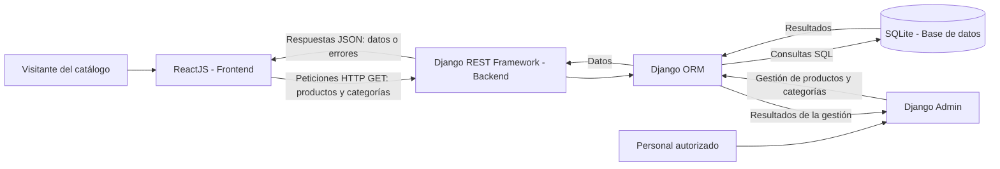

# Análisis y planificación de GameZone Store

**Institución:** TECSUP  
**Curso:** Desarrollo de Aplicaciones Empresariales  
**Laboratorio N.º 13:** Estructura de una aplicación de comercio electrónico  
**Ejercicio 01:** Análisis del negocio y planificación de la aplicación

Este documento presenta la propuesta de la primera versión de GameZone Store. En este ejercicio solo se realiza el análisis y la planificación; la implementación se realizará en una etapa posterior.

## 1. Rubro comercial y nombre del negocio

| Elemento | Definición |
| --- | --- |
| Nombre comercial | GameZone Store |
| Rubro comercial | Venta de videojuegos, periféricos y accesorios gaming por Internet |
| Público objetivo | Personas aficionadas a los videojuegos que buscan juegos y accesorios para sus equipos o consolas |

## 2. Descripción de la tienda y sus productos

GameZone Store es una tienda virtual orientada a los aficionados a los videojuegos. Ofrece videojuegos, controles, teclados, mouse, audífonos y accesorios gaming. Su catálogo permitirá conocer los productos, comparar sus precios en soles peruanos y consultar su disponibilidad.

Para organizar el catálogo se proponen estas categorías iniciales:

| Categoría | Descripción | Ejemplos de productos |
| --- | --- | --- |
| Videojuegos | Juegos para consolas y computadoras | Videojuego de aventura para consola |
| Controles | Mandos para jugar en consolas o computadoras | Control inalámbrico |
| Periféricos | Dispositivos y accesorios para complementar el equipo gaming | Teclados, mouse y audífonos |

## 3. Funcionalidades principales de la primera versión

| Funcionalidad | Descripción |
| --- | --- |
| Visualizar catálogo | Mostrar los productos disponibles en la página principal del catálogo |
| Explorar categorías | Presentar las categorías para que el visitante conozca los tipos de productos ofrecidos |
| Filtrar productos | Permitir seleccionar una categoría y mostrar únicamente sus productos; incluir una opción para ver todos |
| Ver tarjetas con información | Mostrar la imagen, el nombre, la descripción breve, el precio, la categoría y la cantidad disponible de cada producto |
| Administrar productos mediante Django Admin | Permitir al personal autorizado registrar, consultar, editar y eliminar productos, además de organizar sus categorías |

Por ejemplo, al seleccionar **Controles**, el catálogo mostrará solo los productos de esa categoría. Si una categoría no tiene productos, se mostrará un mensaje indicando que no se encontraron resultados.

El acceso administrativo previsto corresponde al personal de la tienda mediante Django Admin. Esta versión no contempla carrito, pedidos, autenticación de clientes ni pagos.

## 4. Información de los productos y las categorías

### 4.1. Entidad Producto

| Campo | Tipo previsto | Descripción y reglas |
| --- | --- | --- |
| id | Entero | Identificador único generado automáticamente |
| nombre | Texto corto | Nombre obligatorio del producto |
| descripción | Texto | Características principales del producto |
| precio | Decimal con dos posiciones | Precio en soles peruanos, mayor o igual a cero |
| categoría | Referencia a Categoría | Categoría obligatoria a la que pertenece el producto |
| imagen_url | URL | Dirección de la imagen del producto; se propone usar una URL en la primera versión |
| cantidad_disponible | Entero | Unidades disponibles, con un valor mayor o igual a cero |

Los precios se representarán con el símbolo **S/**. El tipo decimal permitirá conservar los dos decimales del importe. Un producto con cantidad disponible igual a cero se mostrará como **Agotado**.

### 4.2. Entidad Categoría

| Campo | Tipo previsto | Descripción y reglas |
| --- | --- | --- |
| id | Entero | Identificador único generado automáticamente |
| nombre | Texto corto | Nombre obligatorio y único de la categoría |
| descripción | Texto | Explicación breve del tipo de productos que agrupa |

### 4.3. Relación entre las entidades

La relación entre **Categoría** y **Producto** es de **uno a muchos**: una categoría puede tener cero, uno o varios productos, y cada producto pertenece a una sola categoría. Producto tendrá una referencia a Categoría mediante una clave foránea, que en la base de datos se podrá representar como `categoria_id`.

Por ejemplo, la categoría Periféricos puede contener un teclado, un mouse y unos audífonos. Para conservar la organización del catálogo, se propone impedir la eliminación de una categoría mientras tenga productos asociados.

### 4.4. Productos de ejemplo

Los siguientes datos y precios son referenciales para la planificación:

| id | Nombre | Descripción | Precio | Categoría | Imagen o URL de imagen | Cantidad disponible |
| --- | --- | --- | --- | --- | --- | --- |
| 1 | Videojuego Aventura Espacial | Juego de aventura para consola | S/ 189.90 | Videojuegos | `https://example.com/imagenes/aventura-espacial.jpg` | 12 |
| 2 | Control inalámbrico GZ | Mando inalámbrico para PC | S/ 149.90 | Controles | `https://example.com/imagenes/control-gz.jpg` | 20 |
| 3 | Teclado mecánico RGB | Teclado con iluminación y conexión USB | S/ 229.90 | Periféricos | `https://example.com/imagenes/teclado-rgb.jpg` | 15 |
| 4 | Mouse gaming GZ | Mouse con sensibilidad ajustable | S/ 79.90 | Periféricos | `https://example.com/imagenes/mouse-gz.jpg` | 25 |
| 5 | Audífonos gaming GZ | Audífonos con micrófono integrado | S/ 119.90 | Periféricos | `https://example.com/imagenes/audifonos-gz.jpg` | 10 |

Las URL de `example.com` son ejemplos de formato y no representan imágenes disponibles. En la implementación se elegirán imágenes válidas para los productos.

## 5. Elementos de la interfaz

| Elemento | Responsabilidad |
| --- | --- |
| Header | Mostrar el nombre GameZone Store y el acceso a la página principal del catálogo |
| ProductCard | Presentar un producto con su imagen, nombre, descripción breve, precio, categoría y cantidad disponible o estado Agotado |
| ProductList | Recibir la lista de productos y organizar las tarjetas ProductCard; mostrar un mensaje cuando no existan resultados |
| CategoryFilter | Mostrar las categorías y la opción Todas; comunicar la categoría seleccionada para actualizar el catálogo |
| Página principal del catálogo | Integrar Header, CategoryFilter y ProductList, solicitar los datos al backend y manejar los estados de carga, error y resultados |

### Ejemplo de organización visual

```text
Página principal del catálogo
├── Header: GameZone Store
├── Título: Catálogo de productos
├── CategoryFilter: Todas | Videojuegos | Controles | Periféricos
└── ProductList
    ├── ProductCard: Videojuego Aventura Espacial — S/ 189.90
    ├── ProductCard: Control inalámbrico GZ — S/ 149.90
    └── ProductCard: Teclado mecánico RGB — S/ 229.90
```

## 6. Arquitectura propuesta

El frontend se desarrollará con **ReactJS**, usando **Vite** como herramienta de desarrollo, **Tailwind CSS** para los estilos y **shadcn/ui** para elementos de interfaz. El backend usará **Django REST Framework** para exponer una API. Los datos se almacenarán en **SQLite** y el personal de la tienda administrará productos y categorías desde **Django Admin**.



ReactJS se comunicará con la API mediante HTTP y recibirá respuestas en formato JSON. El frontend no accederá directamente a SQLite: Django realizará las consultas mediante su ORM. Django Admin utilizará los mismos modelos y la misma base de datos.

### Ejemplos de peticiones previstas

Estas rutas son una propuesta para la implementación posterior; todavía no están creadas.

| Petición HTTP | Resultado esperado |
| --- | --- |
| `GET /api/categorias/` | Lista de categorías en formato JSON |
| `GET /api/productos/` | Lista de productos en formato JSON |
| `GET /api/productos/?categoria=2` | Lista de productos de la categoría Controles, suponiendo que su id sea 2 |

Ejemplo de un producto dentro de una respuesta JSON:

```json
{
  "id": 2,
  "nombre": "Control inalámbrico GZ",
  "descripcion": "Mando inalámbrico para PC",
  "precio": "149.90",
  "categoria": 2,
  "imagen_url": "https://example.com/imagenes/control-gz.jpg",
  "cantidad_disponible": 20
}
```

El valor `categoria` hace referencia al id de la entidad Categoría. El precio se representa como una cadena decimal para conservar su precisión en el intercambio de datos.
